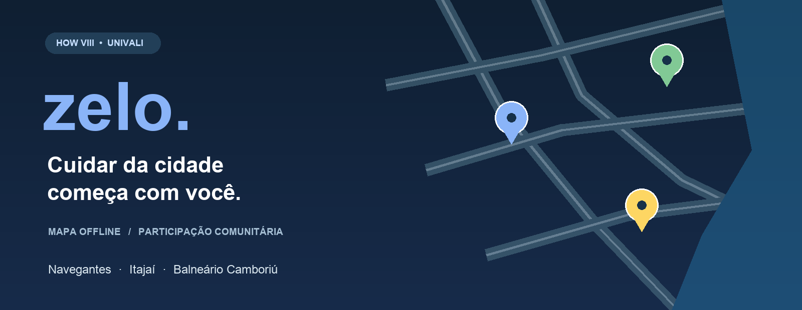

<p align="center">
  
</p>

<p align="center">
  <strong>Uma proposta de participação comunitária para a zeladoria urbana.</strong><br />
  Navegantes · Itajaí · Balneário Camboriú
</p>

<p align="center">
  <a href="#sobre-o-projeto">Projeto</a> ·
  <a href="#funcionalidades">Funcionalidades</a> ·
  <a href="#instalar-o-apk">APK</a> ·
  <a href="#executar-no-vs-code">Instalação</a> ·
  <a href="#solução-de-problemas">Ajuda</a>
</p>

# Zelo

O **Zelo** é um aplicativo Android para localizar, registrar e acompanhar problemas de infraestrutura urbana. A experiência começa no mapa: escolha uma cidade, selecione uma categoria e consulte as ocorrências ou indique um novo ponto para reportar.

O projeto integra o **HOW VIII da Universidade do Vale do Itajaí — UNIVALI** e amplia a proposta de iluminação pública desenvolvida pela equipe no **HOW IV**, projeto Hands on Work realizado no segundo semestre da graduação.

## Sobre o projeto

A proposta surgiu da dificuldade de comunicar problemas urbanos e acompanhar as demandas dos moradores. O Zelo organiza informações como localização, categoria, descrição e prioridade percebida para tornar cada ocorrência mais fácil de identificar.

**Estágio atual:** protótipo acadêmico com dados armazenados no aparelho. A colaboração entre dispositivos e o atendimento oficial das prefeituras são etapas futuras. O cadastro de um relato nesta versão não o envia ao poder público.

## Funcionalidades

| Recurso | Como funciona |
| --- | --- |
| 🗺️ Mapa offline | Ruas e limites municipais ficam incluídos no aplicativo. Não exige chave de API de mapas. |
| 🔎 Busca de ruas | Encontra nomes do catálogo da cidade selecionada e centraliza o mapa. |
| 📍 Pin manual | Permite escolher o local do relato sem usar o GPS, mesmo estando fora da região. |
| 🏙️ Filtros na Home | Seletores de cidade e categoria ficam lado a lado, abaixo da busca. |
| 📝 Novo relato | Categoria, título, referência, descrição, prioridade e fotografia opcional. |
| 💡 Ícones por categoria | Cada tipo de ocorrência tem um símbolo próprio no mapa. |
| 🤝 Apoio e acompanhamento | Permite apoiar registros e reunir os relatos acompanhados. As ações são locais. |
| 📏 Perto de mim | Consulta por distância em raios de 1, 3 ou 5 km, mediante localização. |
| 🌓 Aparência | Temas claro, escuro e automático, com preferência salva. |
| 💾 Persistência | Relatos e fotos são mantidos no armazenamento privado do aplicativo. |

### Categorias de ocorrências

| Ícone ilustrativo | Categoria | Ícone ilustrativo | Categoria |
| :---: | --- | :---: | --- |
| 💡 | Iluminação pública | 🚧 | Obra parada |
| ⚠️ | Buraco na via | 🌊 | Alagamento |
| 🗑️ | Entulho | 💧 | Esgoto a céu aberto |
| 🚶 | Calçada | ⋯ | Outros |
| 🚦 | Sinalização | | |

Os símbolos da tabela são ilustrativos; o aplicativo utiliza Material Icons. A cor do marcador indica **azul para prioridade baixa**, **âmbar para média** e **vermelho para alta**. Ocorrências concluídas usam **verde**, com tonalidades ajustadas ao tema.

### Base de demonstração

O aplicativo inclui **108 ocorrências fictícias**, com **36 em cada cidade** e quatro exemplos de cada categoria por município. Elas apresentam prioridades, apoios e situações variadas para demonstrar a navegação.

Os registros são identificados como exemplos. Seus títulos, apoios e históricos não representam reclamações reais nem ações oficiais. Na atualização dessa base, somente os exemplos anteriores são substituídos; os relatos criados pelo usuário são preservados.

## Instalar o APK

O APK de demonstração permite abrir o Zelo **sem VS Code, Android Studio ou Metro**. O mapa e os dados de exemplo ficam incluídos no aplicativo.

1. Acesse a seção **Releases** deste repositório, quando o APK estiver publicado.
2. Baixe `Zelo-2.0.0-android-arm64.apk` no Android.
3. Abra o arquivo e, se solicitado, autorize a instalação por esse navegador ou gerenciador de arquivos.
4. Conclua a instalação e abra o **Zelo, com ícone azul**.

O pacote exige Android 7.0 (API 24) ou superior e processador ARM64 compatível. Esta distribuição é para demonstração acadêmica e utiliza a assinatura de desenvolvimento do projeto; não é uma publicação na Google Play. Uma instalação existente com outra assinatura pode impedir a atualização. Desinstalar apaga os dados locais.

> A seção Releases só terá o arquivo após seu envio pelo responsável pelo repositório. Este README não cria uma publicação automaticamente.

## Publicar o APK no GitHub

Para disponibilizar o instalador sem colocá-lo no histórico do código:

1. Abra o repositório no GitHub e acesse **Releases → Draft a new release**.
2. Escolha uma tag, por exemplo `v2.0.0-demo`, e informe um título para a demonstração.
3. Anexe `Zelo-2.0.0-android-arm64.apk` e, se disponível, `SHA256SUMS.txt`.
4. Descreva a versão como **protótipo local de demonstração para Android ARM64**.
5. Publique a release e compartilhe o link.

Para atualizar a apresentação do repositório, adicione este `README.md` à raiz e preserve a imagem em `docs/images/zelo-cover.png`. O APK tem aproximadamente 78 MB; mantê-lo nos anexos de uma release evita aumentar o histórico Git a cada versão.

## Executar no VS Code

Estas instruções utilizam **macOS**, como no ambiente de desenvolvimento da equipe.

### 1. Preparar as ferramentas

Instale o Node.js **22.13 ou superior**, o VS Code e o Android Studio. O projeto utiliza npm; suas dependências estão definidas em `package-lock.json`.

No Android Studio, abra **Tools → SDK Manager** e confira os componentes do SDK solicitados pela compilação. Na aba **SDK Tools**, mantenha disponíveis Android SDK Platform-Tools e Android SDK Command-line Tools. A primeira compilação também poderá baixar NDK e CMake.

Abra **Tools → Device Manager**, crie um dispositivo virtual se necessário e clique em **▶**. Aguarde aparecer a tela inicial do Android.

### 2. Configurar Java e SDK

No terminal do VS Code, configure o Java incluído no Android Studio e o caminho padrão do SDK:

```bash
export JAVA_HOME="/Applications/Android Studio.app/Contents/jbr/Contents/Home"
export ANDROID_HOME="$HOME/Library/Android/sdk"
export PATH="$JAVA_HOME/bin:$ANDROID_HOME/platform-tools:$PATH"
```

Confira as ferramentas:

```bash
java -version
node -v
adb devices
```

O emulador deve aparecer na lista com o estado `device`. Para manter as variáveis nos próximos terminais, adicione as três linhas `export` ao arquivo `~/.zshrc`, evitando duplicá-las, e abra um novo terminal.

### 3. Abrir a pasta e instalar

No VS Code, use **File → Open Folder** e abra a raiz do projeto, onde está o arquivo `package.json`. A pasta local pode continuar com o nome `Zelo-Flutter`; o código atual utiliza React Native.

No terminal dessa pasta:

```bash
npm ci
npm run android
```

O primeiro comando instala as dependências do arquivo de lock. O segundo compila e instala a versão de desenvolvimento no emulador. Deixe o terminal aberto e aguarde a compilação terminar.

### 4. Continuar o desenvolvimento

Com a versão de desenvolvimento já instalada:

```bash
npm start
```

Mantenha o Metro aberto durante o uso. Alterações em TypeScript e na interface podem ser recarregadas; mudanças nas dependências ou configurações nativas exigem uma nova execução de `npm run android`.

**Mapa offline e desenvolvimento são coisas diferentes:** os dados cartográficos são locais, mas a versão de desenvolvimento precisa do Metro para carregar o código. O APK de demonstração tem esse código incluído.

## Como criar uma ocorrência

1. Na Home, selecione **Navegantes**, **Itajaí** ou **Balneário Camboriú**.
2. Toque em **Escolher ponto no mapa**. Você também pode manter um ponto pressionado no mapa principal.
3. Busque uma rua ou arraste o mapa até o pin central indicar o local correto. Use os botões de zoom ou o gesto de pinça.
4. Confirme o ponto dentro de uma das cidades atendidas.
5. Escolha a categoria e a prioridade, preencha o título, a referência e a descrição e adicione uma foto, se desejar.
6. Salve o relato. Ele passa a aparecer no mapa e na aba **Acompanhando**.

A fotografia é opcional e deve ter até **20 MB**. Confira o endereço sugerido pelo catálogo antes de salvar. A seleção manual não pede localização; o botão **GPS** é uma alternativa e utiliza localização em primeiro plano.

### Navegação principal

- **Mapa:** visão das ocorrências, busca, filtros e início do cadastro.
- **Perto de mim:** registros ordenados pela distância à última posição obtida. Atualize a posição ao mudar de local.
- **Acompanhando:** registros marcados para acompanhamento, incluindo seus novos relatos.

## Solução de problemas

### Unable to locate a Java Runtime

O terminal não encontrou o Java. Execute os comandos de configuração da seção anterior e confira `java -version` antes de repetir `npm run android`.

Se surgir um erro de compatibilidade de versões, confira o JDK selecionado: a compilação de referência do projeto foi realizada com **JDK 21**.

### Android sdkmanager not found

No Android Studio, abra **Tools → SDK Manager → SDK Tools**, marque **Android SDK Command-line Tools (latest)** e aplique. Aceite as licenças solicitadas. Confira também se `ANDROID_HOME` aponta para a instalação correta.

### Unable to load script

O aplicativo de desenvolvimento não encontrou o Metro. No terminal da raiz do projeto:

```bash
npm start -- --clear
```

Deixe esse terminal aberto. Em outro terminal:

```bash
"$HOME/Library/Android/sdk/platform-tools/adb" reverse tcp:8081 tcp:8081
```

No emulador, abra o menu de desenvolvimento com **⌘ + M**. Em **Change Bundle Location**, informe `localhost:8081`, aplique e toque em **Reload**. Caso o Android solicite autorização para conexão à rede local, permita.

O redirecionamento pode precisar ser repetido após reiniciar o emulador. Se houver vários dispositivos conectados, selecione o desejado com `adb -s IDENTIFICADOR reverse tcp:8081 tcp:8081`, usando o identificador exibido em `adb devices`.

### Nenhum dispositivo encontrado

Abra o emulador pelo Device Manager e aguarde sua inicialização. Confira a conexão com `adb devices`. Um aparelho físico precisa ter a depuração USB ativada e autorizar a conexão ao computador.

### GPS fora da região atendida

Use **Escolher ponto no mapa**. A posição do aparelho pode estar em outra cidade; o que precisa estar dentro da cobertura é o ponto confirmado para o relato.

## Tecnologias e organização

| Tecnologia | Uso no Zelo |
| --- | --- |
| React Native e React | Interface móvel e componentes |
| TypeScript | Tipos, regras e fluxos |
| Expo e Expo Router | Integrações nativas e entrada da aplicação |
| react-native-svg | Mapa vetorial local |
| Expo Location | Localização em primeiro plano |
| Expo ImagePicker | Seleção de fotografias |
| Expo FileSystem | Arquivos privados, relatos e preferências |
| Material Icons | Símbolos da interface e das categorias |
| Node test runner e tsx | Testes automatizados de domínio |
| TypeScript e ESLint | Análise estática e verificação do código |

```text
Zelo-Flutter/
├── src/
│   ├── app/                 # Telas, navegação e formulários
│   ├── components/          # Mapa vetorial e gestos
│   ├── domain/              # Geografia, catálogo e regras dos relatos
│   ├── services/            # GPS, fotos e persistência
│   └── theme.ts             # Paletas clara e escura
├── assets/                  # Ícone e catálogo cartográfico
├── android/                 # Projeto nativo Android
├── tests/                   # Testes de domínio
├── docs/images/             # Imagens deste README
├── licenses/                # Licenças de componentes de origem
├── app.config.ts            # Configuração Expo
└── package.json             # Dependências e comandos
```

## Verificação e testes

Na raiz do projeto, execute:

```bash
npm run typecheck
npm run lint
npm test
```

A suíte cobre geografia, validade do GPS, busca por proximidade, falhas de gravação, ações concorrentes, preferências de tema, projeção e movimento do mapa. Também verifica a distribuição dos 108 exemplos e sua migração sem remover relatos pessoais.

Os testes de domínio não substituem a validação no aparelho. Permissões, seleção de fotos, desempenho, teclado, navegação e restauração após encerrar o processo precisam de avaliação em dispositivos e com usuários.

## Dados cartográficos e limites

O catálogo embarcado contém **12.807 trechos viários** provenientes do OpenStreetMap e limites municipais simplificados do IBGE. A base pode apresentar lacunas e não identifica números de imóveis automaticamente.

O estilo visual utiliza vias hierarquizadas, água azul e cores ajustadas aos temas. Não há API do Google Maps, trânsito em tempo real, imagens de satélite ou catálogo atualizado de estabelecimentos.

Os relatos, apoios e acompanhamentos ficam na instalação atual. Não há contas, sincronização entre aparelhos, respostas oficiais ou envio automático à prefeitura. Desinstalar o aplicativo remove seus dados locais.

## Próximas etapas

- Validar o cadastro completo, permissões e persistência em dispositivos.
- Avaliar a usabilidade com moradores.
- Implementar backend, sincronização e autenticação.
- Definir moderação, responsabilidades e integração com gestores municipais.
- Revisar os alertas de dependências antes de uma publicação pública.

## Equipe

- **Erick Lucas Martins**
- **Rayltson Henrique Lemes**
- **Yan Victor dos Santos Rocha**

Curso de Análise e Desenvolvimento de Sistemas · **UNIVALI** · HOW VIII.

## Atribuições

Os dados de ruas são atribuídos aos **OpenStreetMap contributors**, sob ODbL 1.0. Consulte [`assets/NOTICE.txt`](assets/NOTICE.txt) e [`assets/ODbL-1.0.txt`](assets/ODbL-1.0.txt). Os limites municipais têm origem no **IBGE**. A licença do template Expo está preservada em [`licenses/Expo-template-MIT.txt`](licenses/Expo-template-MIT.txt).

A capa deste README é uma ilustração editorial, não uma captura de tela do aplicativo.
